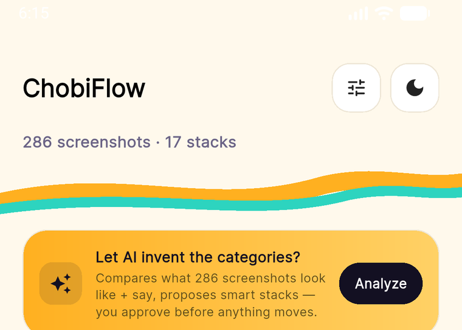
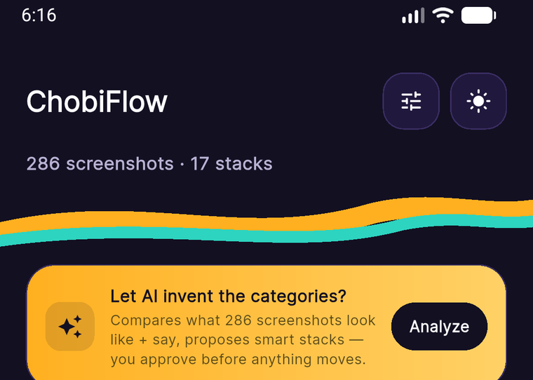
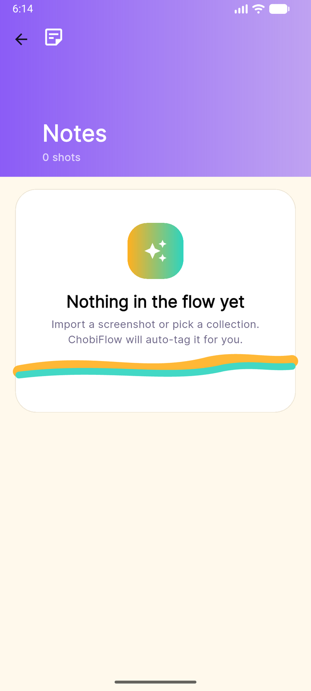
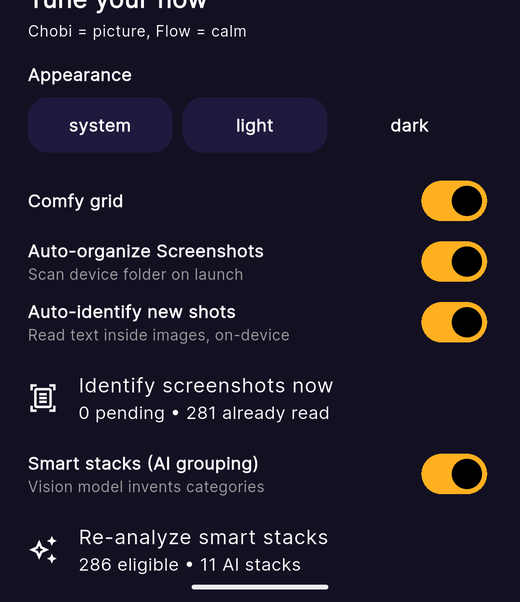
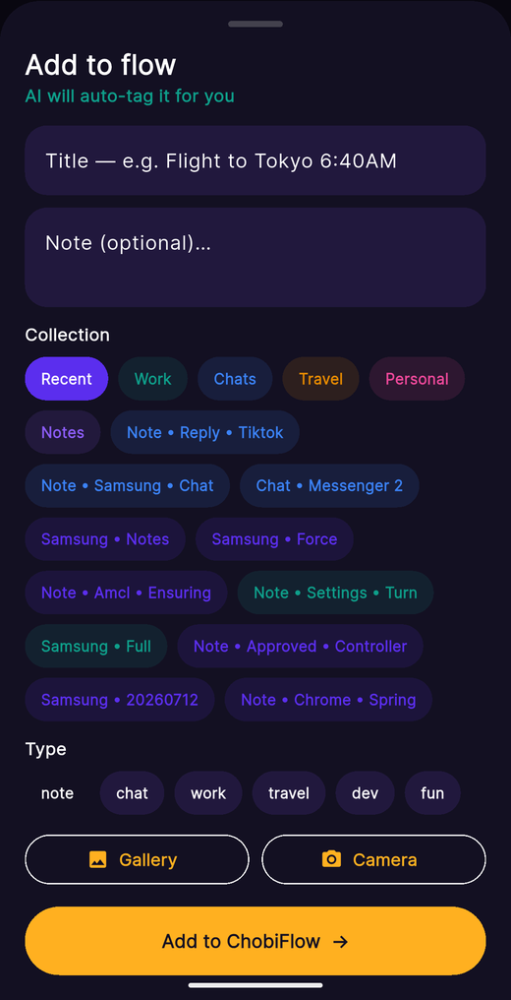

<div align="center">


# ChobiFlow

### Flow through your screenshots.

ChobiFlow auto-imports your Screenshots folder, lets on-device AI sort them into stacks you approve, and searches inside every image — with **zero** servers, **zero** accounts, and **zero** fees.

</div>

_Cho-bi_ = picture in Bangla · _Flow_ = calm

<p align="center">
  <a href="https://skillicons.dev">
    
  </a>
</p>

<p align="center">
  · <a href="https://developers.google.com/ml-kit">ML Kit OCR</a> (on-device text) ·
  <a href="https://onnxruntime.ai">ONNX Runtime</a> + <a href="https://huggingface.co/felixhrdyn/mobileclip2-s0-onnx">MobileCLIP2-S0</a> (on-device vision) ·
  hand-painted dark-first theme ·
</p>

---

[](https://github.com/Mostakim52/ChobiFlow/releases)
[](https://flutter.dev)
[](https://dart.dev)
[](https://github.com/Mostakim52/ChobiFlow/releases)
[](LICENSE)

---

## Download

Grab the latest APK from the [**Releases**](https://github.com/Mostakim52/ChobiFlow/releases) page:

| Package | Size | For |
|---------|------|-----|
| `chobiflow-v1.0.0-universal.apk` | ~164 MB | any Android 7.0+ device |
| `chobiflow-v1.0.0-arm64.apk` | ~59 MB | modern phones incl. Galaxy S2x |

Install: enable *"Install unknown apps"* for your browser or file manager, then tap the APK. First launch downloads the ~43 MB vision model once (Wi-Fi friendly), afterwards **everything runs offline**.

---

## Screens

| Flow home (light) | Flow home (dark) | Empty page |
|-------------------|------------------|------------|
|  |  |  |
| **Settings** | **Add to flow** | |
|  |  | |

---

## The premise

You screenshot *everything* — receipts, flights, chats, menus, errors — and three months later the receipt is gone. ChobiFlow fixes the last half: **land** into organized stacks, not a swamp.

- **Auto-organize** — every screenshot lands in `Recent` by default
- **Smart Stacks** — the vision model groups shots by *what they look like*; you approve before anything moves
- **Identify** — OCR reads inside each shot (`flight BOM-SIN`, `₹1,250 paid`, `error: build failed`) and re-sorts by content — no filenames needed
- **Search that sees inside images** — query the read text, not just the title

On a real ~286-shot Samsung library the first identify + AI pass takes a couple of minutes, then it's instant and incremental.

---

## Signature theme — Marigold Flow on Ink

Not another cream-and-serif clone. ChobiFlow is **midnight ink + marigold glow + teal current**.

| Token | Hex | Role |
|-------|-----|------|
| `ink` | `#131022` | dark bg, FAB, chips |
| `plum` | `#21183D` | dark surface |
| `marigold` | `#FFB020` | primary glow, selection, CTA |
| `flowTeal` | `#2DD4BF` | secondary, AI, links |
| `cream` | `#FFF9EC` | light bg |
| `violet` | `#5B2EEE` | light primary |
| `blush` | `#FF6B6B` | danger |

- **Type:** `Sora` display (800–900, -1.5 tracking) · `Inter` body — via `google_fonts`
- **Shape:** 28px cards, 99px pills, 3px white photo borders
- **Signature:** the **Flow Ribbon** — dual marigold + teal S-curve, custom-painted, repeated on Home, onboarding, empty states and detail. One memorable stroke, everything else quiet.

---

## How the intelligence works

```
scan (MediaStore, all Screenshots albums, path-normalized dedupe)
  → import (batched, one persist)
  → identify (ML Kit OCR per shot → content keywords → auto re-sort)
  → analyze (MobileCLIP2-S0 embeddings + Jaccard fusion, 0.78→0.72→0.66
             adaptive threshold, large-group re-split, named by OCR keywords)
  → approve (you see exactly which shots + similarity before Create)
```

Nothing leaves the phone — no telemetry, no network calls after the model download, works fully in airplane mode.

## Features (auto-synced) <!-- FEATURES:START -->

> This block is generated by `dart tool/sync_readme.dart`. **Do not edit by hand.**
> Any feature change in `lib/` must re-run the sync so README stays truthful.

| # | Feature | Where | Status |
|---|---------|-------|--------|
| 1 | Onboarding flow (3 animated pages, Skip, Start flowing) | `lib/screens/onboarding.dart` | ✅ |
| 2 | Smart Flow Home — wordmark header, quiet counts, ribbon | `lib/screens/home_shell.dart → _FlowTab` | ✅ |
| 3 | Collections grid (Recent, Work, Chats, Travel, Personal, Notes + custom) with fanned stacked preview | `lib/widgets/flow_widgets.dart → FanStack` | ✅ |
| 4 | Global search (title, note, tags) + live results | `lib/screens/home_shell.dart → _SearchTab` | ✅ |
| 5 | Filter chips — All / Favorites + Sort (newest/oldest/name) | `lib/flow_store.dart → FilterMode/SortMode` | ✅ |
| 6 | Screenshot detail — Hero image, collection pill, #tags, AI badge, move-to rail | `lib/screens/detail.dart` | ✅ |
| 7 | Favorite / Share (`share_plus`) | `lib/flow_store.dart`, `detail.dart` | ✅ |
| 8 | Multi-select mode — long-press, batch fav / move | `home_shell.dart`, `detail.dart` | ✅ |
| 9 | Add via Gallery / Camera (`image_picker`) + on-device auto-tag | `home_shell.dart → _AddSheet` | ✅ |
| 10 | Create / Rename / Delete collections (custom color + icon) | `flow_store.dart` | ✅ |
| 11 | Settings — Light / Dark / System, Comfy/Compact grid, persistence | `home_shell.dart → _SettingsSheet` | ✅ |
| 12 | Offline persistence (`shared_preferences` JSON, batched writes) | `lib/flow_store.dart` | ✅ |
| 13 | Real Screenshots-folder import (all albums: DCIM + Pictures, normalized-dedupe, batched) | `lib/device_import.dart`, `flow_store.dart → importDeviceShots` | ✅ |
| 14 | Import report sheet (per-stack breakdown, tap to inspect) | `home_shell.dart → _ImportReportSheet rows` | ✅ |
| 15 | Large-library performance (virtualized sliver grid, 480px thumbs, batched persist) | `flow_widgets.dart → ShotMasonrySliver`, `flow_store.dart` | ✅ |
| 16 | On-device identification (ML Kit OCR: reads inside each image, content tags, auto re-sort, OCR search) | `flow_store.dart → runOcrBatch`, `device_import.dart → keywords/guessFromText` | ✅ |
| 17 | Smart Stacks (MobileCLIP2-S0 FP32 vision embeddings — calibrated /255-only input contract, INT8 rejected as broken — self-discovered clusters, approve-before-apply) | `smart_stacks.dart`, `flow_store.dart → runSmartAnalysis/applySmartProposals` | ✅ |
| 18 | Full-library AI re-sort (all albums, adaptive similarity, per-stack approve toggles) | `flow_store.dart → smartEligible/adaptive cluster`, preview sheet | ✅ |

<!-- FEATURES:END -->

**To add a feature and keep README honest:**

```powershell
# 1. implement in lib/
# 2. register it in tool/sync_readme.dart -> features list
# 3. run:
dart tool/sync_readme.dart
```

---

## Architecture

```
lib/
  main.dart                 # bootstrap, splash, themeMode wiring, onboarding gate
  chobi_theme.dart          # "Marigold Flow on Ink" theme + FlowRibbon painter
  models.dart               # ShotItem (+ocrText/ocrDone), ShotCollection (+isAuto)
  flow_store.dart           # ChangeNotifier store: CRUD, search/filter/sort,
                            # importDeviceShots (batched), runOcrBatch,
                            # runSmartAnalysis, applySmartProposals
  device_import.dart        # MediaStore scan of ALL screenshot albums, norm(),
                            # keywords(), guessFromText(), guessCollectionId()
  smart_stacks.dart         # MobileCLIP2-S0 ONNX embedder, cosine + jaccard,
                            # discoverClusters(), refineLargeGroups(), naming
  widgets/flow_widgets.dart # ShotThumb (480px thumbs), virtualized ShotMasonrySliver,
                            # Entrance, FanStack, EmptyFlow
  screens/
    onboarding.dart         # 3-page intro
    home_shell.dart         # Flow / Stacks / Search tabs + Add + Settings sheets
    detail.dart             # Hero detail + actions + move rail
assets/icon/                # chobiflow_icon.png + android mipmaps
tool/sync_readme.dart       # README feature-table generator (source of truth)
test/                       # boot smoke, classification probes, overflow guard
```

- **State:** single `FlowStore` (`ChangeNotifier`) + `AnimatedBuilder`. No BLoC/Riverpod — deliberate for a utility app.
- **Persistence:** `shared_preferences` JSON (`chobiflow_shots_v1`, `chobiflow_cols_v1`), batched single-persist jobs so a 500-shot library never janks the UI.
- **Vision:** FP32 `vision_model.onnx` (~43 MB, downloaded once to app docs). OpenAI-CLIP preprocessing *hurt* accuracy here — the calibrated `/255`-only contract measured higher cluster purity, so that's what ships.

---

## Build from source (Windows)

Flutter lives at `C:\flutter\bin` here — adjust to yours.

```powershell
# 1. deps
C:\flutter\bin\flutter.bat pub get

# 2. gates
C:\flutter\bin\flutter.bat analyze
C:\flutter\bin\flutter.bat test

# 3. run on a device
C:\flutter\bin\flutter.bat run -d emulator-5554

# 4. ship
C:\flutter\bin\flutter.bat build apk --release                 # universal, signed
C:\flutter\bin\flutter.bat build apk --release --split-per-abi # per-ABI, leaner
```

**Release signing:** `android/key.properties` + `android/keystore/*.jks` hold the upload key and are **gitignored** — a fresh clone falls back to the debug key automatically so everyone can build. Create your own key with:

```powershell
& "C:\Program Files\Android\Android Studio\jbr\bin\keytool.exe" -genkeypair `
  -keystore android\keystore\chobiflow-release.jks -alias chobiflow `
  -keyalg RSA -keysize 2048 -validity 10000
```

---

## Roadmap

- [ ] Near-duplicate detection (pHash) + burst/event grouping
- [ ] Semantic ("blue boarding pass") search via the CLIP text encoder
- [ ] Optional, opt-in cloud stack *summaries* (text-only, never images)
- [ ] Homescreen widget — "Today in flow"
- [ ] Share-in (OS picker → ChobiFlow)

---

## Contributing

1. Pick a roadmap item or file an issue.
2. Implement in `lib/` + add a test if it's pure logic.
3. Register the feature in `tool/sync_readme.dart` and run `dart tool/sync_readme.dart`.
4. `flutter analyze` + `flutter test` must pass — paste the output in the PR.

---

<div align="center">

**ChobiFlow — don't scroll. Flow.**

_If this saved you one frantic "where is that screenshot?!" moment, star it and tell a hoarder._

</div>
